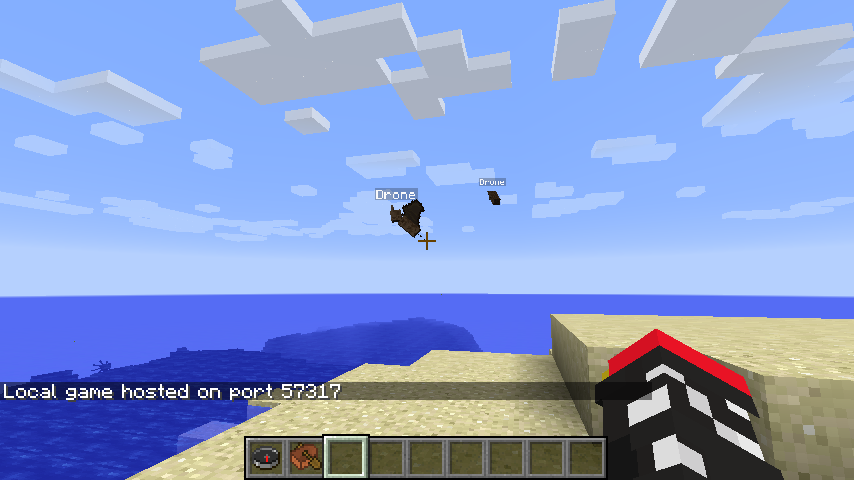
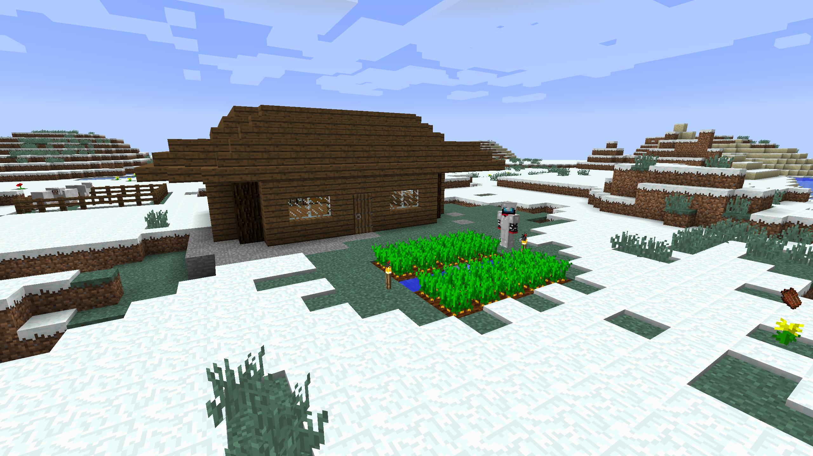
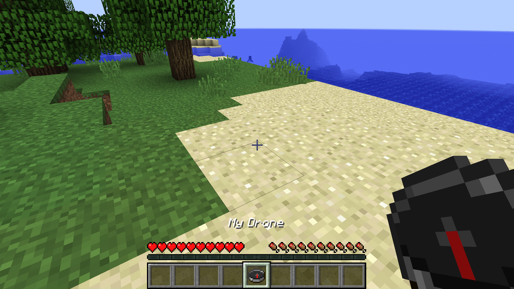
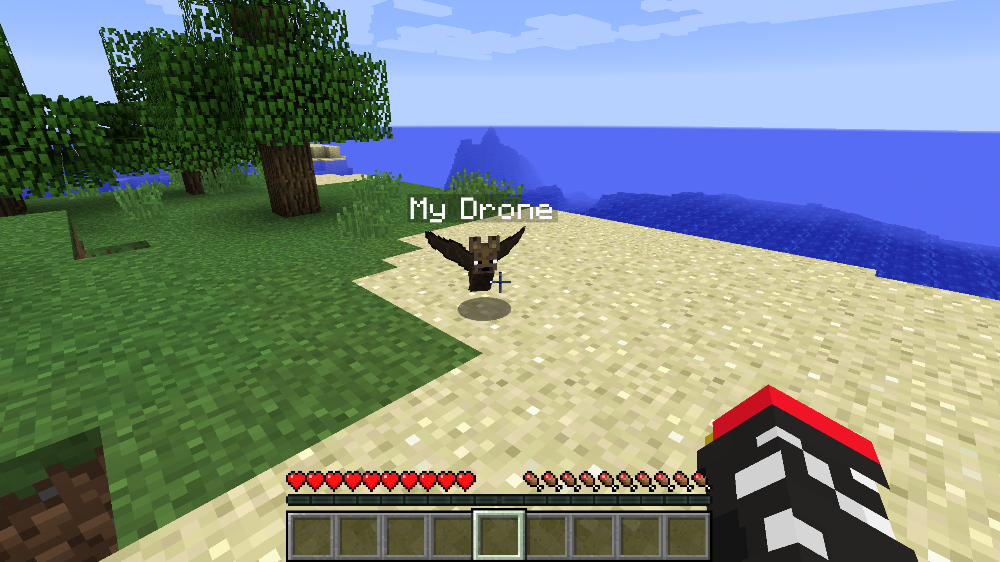

# DronesMC

A craftable physical drone camera for Minecraft 1.12.2, built against Forge 14.23.5.2859, using Java 8. Install the same JAR on the client and server. No additional mods are required.

## Screenshots

| **Drones in flight** | **Drone camera view** |
| :---: | :---: |
|  |  |
| **Drone item** | **Deployed drone** |
|  |  |

The current beta uses the vanilla compass icon and bat model/texture as placeholders.

## Gameplay

Right-click a block with the Drone item to deploy it. Right-click an unoccupied drone to pilot it. Drones are independent world entities, like boats or minecarts: there is no per-player deployment limit or permanent owner. Any player can pilot an unoccupied drone; each player controls one at a time.

| Input | Action |
| --- | --- |
| Mouse | Look around |
| WASD | Move horizontally relative to camera yaw |
| Space / Left Shift | Ascend / descend |
| Ctrl | Fly faster |
| R | Toggle between the player and selected hovering drone |
| Ctrl+R | Cycle hovering drones; print the selected name in client chat |
| Ctrl+E | Exit and request autonomous return and landing |

Movement has no inertia or gravity and respects solid-block collision. The player's body stays stationary and vulnerable. Flight stays in loaded terrain near the pilot's body; drones never force chunks to remain loaded.

Ctrl+E flies toward a safe surface within 3 horizontal blocks of the player's position when requested, then descends. It does not teleport or recover the drone. The bounded route search may fail in complex terrain; failure leaves the drone hovering and reports a message. Landing avoids liquids, magma, cactus, fire, obstructed spaces, and non-full support blocks. Pilot disconnects trigger the same safe landing sequence using the last anchored player position, with a bounded fallback near the drone if needed. Pending landings survive save/reload and resume when the chunk is loaded; no chunks are force-loaded. Previously hovering drones without a saved landing request can be piloted and landed with Ctrl+E.

Any successful positive damage converts the drone to exactly one intact dropped item. Punch it to recover it; right-clicking pilots it. Dropped items remain subject to normal item hazards. Rename the item in an anvil before deployment to give the drone a visible custom label; recovery preserves the name. Unnamed drones display “Drone.” Labels use vanilla nameplate rendering within 64 blocks.

Craft with 4 iron ingots, 1 redstone dust, 2 feathers, 1 glass pane, and 1 compass:

```text
Iron      Redstone    Iron
Feather   Glass pane  Feather
Iron      Compass     Iron
```

The item is also in the Creative Transportation tab. The beta uses a vanilla compass item icon and the vanilla bat model/texture; it has no ordinary bat AI, battery, durability, or health pool.

## Configuration

Forge generates `config/dronesmc.cfg`. Speeds are server-side blocks per tick:

| Setting | Default |
| --- | --- |
| `flight.normalSpeed` | `0.55` (11 blocks/second at 20 TPS) |
| `flight.sprintSpeed` | `1.1` (22 blocks/second at 20 TPS) |
| `landing.landingRadius` | `3` blocks |

Existing configuration values are preserved. If upgrading from the initial beta defaults (`0.25` / `0.5`), explicitly change those settings to `0.55` / `1.1` for the revised Creative-like speed. Restart the client/integrated server or dedicated server after configuration changes. Rename and deployment changes also apply to previously saved drones; legacy owner data and deployment ledgers are no longer used.

## Build and validation

Use a Java 8 JDK with the bundled Gradle 4.9 wrapper and pinned ForgeGradle 3.0.197:

```powershell
.\scripts\Build.ps1 -JavaHome 'C:\path\to\jdk8'
```

The build runs JUnit checks and `reobfJar`. The distributable is `build/libs/dronesmc-0.1.1-beta.jar`; the supplied compiled copy is in `dist/`. Optional `-CacheDirectory` and `-BuildDirectory` relocate large build data to another drive. Do not distribute the mapped development classes.

`scripts/Start-TestClient.ps1` launches an isolated local test profile using an existing Prism Launcher cache for Minecraft 1.12.2, Forge 14.23.5.2859, and LWJGL 2. It verifies cached library hashes, installs the built JAR, and sets the test client's master volume to 0%. It does not read account credentials or authenticate the test profile to online servers. Use a separate instance directory; never point it at a personal Minecraft instance. `-Baseline` omits JAR installation and requires a directory without an existing DronesMC JAR.

Functional tests use minimal Forge. The supplied client modpack is only used for startup/world-loading compatibility; its 29 supplied mods remain installed. Dedicated-server bundle compatibility is recorded separately. See [TESTING.md](TESTING.md) for actual results and remaining verification.

## Forgejo CI and development releases

Implementation: `.forgejo/workflows/main.yml` runs on the existing Linux runner's `ubuntu-22.04` label in a digest-pinned Node Bookworm container. Pinned checkout, Java setup and artifact actions provide Temurin **8u472**, verified downloads, and artifact transfer. Host Java is not used. Gradle remains **4.9**, ForgeGradle **3.0.197**, and Minecraft/Forge **1.12.2 / 14.23.5.2859**. Container utilities come from Debian's signed package repositories; those package versions and upstream dependency repositories are not an offline dependency lock.

The plan enforced by job dependencies is build → dedicated-server smoke test → signing and publication. `scripts/ci/build.sh` runs a clean Gradle build, existing JUnit tests and `reobfJar`. `artifact.py` derives the version from `build.gradle`, checks matching resource/compiled mod metadata, Forge compatibility, Java 8 class versions and SRG remapping evidence, and selects only the regular distributable JAR. It stages that file with `build.json` and `SHA256SUMS`. Development, test, source and Javadoc JARs are excluded.

The Minecraft job downloads this artifact without compiling again. It verifies SHA-256 before installing the JAR in a disposable Forge 2859 server. It requires the Forge server loaded-mod list and DronesMC initialization message, world readiness, at least ten subsequent healthy seconds, and successful `stop`/world-save evidence. The server binds to **127.0.0.1**, keeps online authentication enabled, disables RCON/query and publishes no host ports. This test accepts the Minecraft EULA for its disposable server. Installer execution and startup each have a ten-minute timeout; normal shutdown has sixty seconds, followed by bounded process cleanup on failure. The installer is retrieved over verified HTTPS and its SHA-256 is recorded; it is not independently pinned to an out-of-band digest.

Validation: pushes of tags matching `v*` or `V*`, and pull requests targeting `main` run checks. In Forgejo **Actions → DronesMC build, smoke test and signed releases → Run workflow**, select a branch containing the workflow to run `workflow_dispatch`; manual runs validate without publishing or reading production signing/publication secrets. Builds also run mocked publisher tests and a real GPG test using a disposable password-protected key, including an incorrect-password failure check. Pull requests never receive the three release secrets. Do not enable release credentials in pull-request jobs.

Successful **tag pushes matching `v*` or `V*` only** can publish. Pushes to `main` do not start a workflow. The tagged commit must belong to `main` history; lightweight and annotated tags are supported. Configure repository Actions secrets:

| Secret | Purpose |
| --- | --- |
| `CI_KEY_B64` | Base64 export of one password-protected primary GPG signing key and its signing subkey, if applicable. Multiple primary keys are rejected. |
| `CI_KEY_PASSPHRASE` | Nonempty signing-key password. |
| `GH_KEY` | GitHub token for `firebadnofire/dronesmc`, with repository contents write access for source refs and releases. |

Forgejo release API operations use the job's automatic token, which must permit repository tag/release writes. No permanent Forgejo PAT is stored in this repository. GitHub creation, if needed, requires the token to create a public repository under `firebadnofire`; otherwise create the empty intended public repository first and grant a repository-scoped token access. An existing private repository, fork, unrelated/non-fast-forward history, or nonempty repository without `main` causes synchronization to stop for review. Source synchronization uses an ephemeral `GIT_ASKPASS` helper, never credentials in Git URLs, command arguments or persistent configuration. No GitHub Actions workflow is installed, so the mirror cannot trigger this publishing pipeline on GitHub.

`sign.sh` uses a temporary mode-0700 GPG home, selects the sole imported primary key explicitly, signs the JAR and checksum manifest, verifies both signatures and checks `sha256sum --check --strict`. Private key material is removed before publication. `publish.sh` imports only the exported public key into another temporary home for verification. These helpers execute only in the protected release job; they do not receive secrets during ordinary builds or Minecraft testing. Protect `main` and review changes to workflow/helpers because release jobs execute code from that branch.

`release.py` verifies matching build/runtime evidence, synchronizes the exact AGPL source commit to GitHub without force-pushing, and checks the remote commit and license. Both platforms use the exact pushed tag, preserving its case (for example `v0.0.1` or `V0.0.1`), and **Development Build <sha12>** titles. Tag names do not override the authoritative mod version in `build.gradle`. Release notes derive the beta version from build metadata and identify the commit, platform baselines and actual automated checks. Both releases stage as drafts, check asset names and reported binary/checksum sizes without downloading assets, then finalize with **draft=false, prerelease=false**. The `-beta` suffix stays in the mod version, filename and notes. Beta software is intentionally presented as an ordinary release.

Each release uploads exactly:

```text
dronesmc-<version>.jar
dronesmc-<version>.jar.asc
SHA256SUMS
SHA256SUMS.asc
```

Obtain the maintainer's public key and fingerprint through a trusted channel; a signature proves authenticity only when the key is trusted. Verify downloaded files with:

```bash
gpg --import maintainer-public-key.asc
gpg --fingerprint
gpg --verify SHA256SUMS.asc SHA256SUMS
sha256sum --check --strict SHA256SUMS
gpg --verify dronesmc-<version>.jar.asc dronesmc-<version>.jar
```

Recovery: the two release APIs cannot commit atomically. If one target finalizes and the other fails, the workflow fails visibly. Rerun the failed release job with the **original build and Minecraft artifacts** and same signing key; existing binaries/manifests must match exactly. Valid older signatures are retained and reused across platforms, since fresh detached signatures may differ. Existing tags are never retargeted, published binaries are never replaced, and a published release missing assets requires manual review. A new full build can have different ZIP timestamps, even for the same source commit; such a binary must not replace an existing tagged release. Retain the original CI artifacts until publication/recovery completes. Do not delete or retarget a public tag to bypass a mismatch.

Reproduce on Linux with the pinned Java 8 JDK on `JAVA_HOME`/`PATH`, Python 3, Git, GPG and Bash:

```bash
python3 -m unittest discover -s scripts/ci/tests -v
bash scripts/ci/build.sh
python3 scripts/ci/signing_preflight.py
python3 scripts/ci/smoke.py ci-dist smoke-result
```

Build staging fails clearly if `ci-dist` is already populated, preserving that evidence instead of overwriting it. Use a fresh checkout or move prior CI staging aside before a new build. Existing Windows build/client scripts remain supported. For smoke failures download `minecraft-evidence`: `result.json` independently records startup, loaded-mod proof, observation and shutdown; `installer.log`, `console.log`, Forge logs and crash reports identify dependency, classloading or startup failures. Build evidence includes the Gradle logs and JUnit XML. No dedicated-server smoke result establishes client rendering, flight controls, multiplayer synchronization or full modpack compatibility; see `TESTING.md` for executed evidence and remaining limits.

To publish, tag the intended tested commit on `main` and push that one tag. Either lowercase `v` or uppercase `V` starts the full build, smoke test and signed two-platform release pipeline. Creating a tag locally alone does not trigger CI. Do not reuse or move an existing release tag.

```bash
git tag v0.0.1
git push origin v0.0.1
# Alternatively use V0.0.1 with uppercase V.
```

Release recovery: `.forgejo/workflows/recover-release.yml` is a separate publishing workflow. Dispatch it on `main` with the existing release tag and the original tag run API ID (for example `v0.0.1`, `918`). This deliberately finishes publication; the ordinary main workflow manual dispatch remains validation-only. Recovery downloads the original distributable and Minecraft evidence, validates the original successful build/smoke jobs and commit, and never recompiles the mod or moves its tag. Remote asset downloads are skipped by explicit publication policy. Local SHA-256 and GPG checks remain mandatory. Existing assets are retained; signatures can differ between platforms after recovery, and remote bytes/signatures are not independently verified. No additional Forgejo API token is required. A missing/expired artifact, failed original check, commit/hash mismatch or invalid signature stops recovery.
